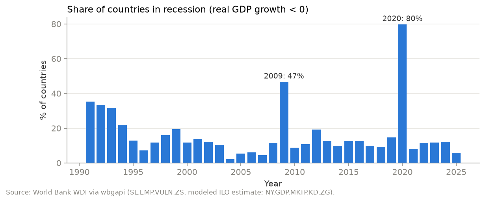
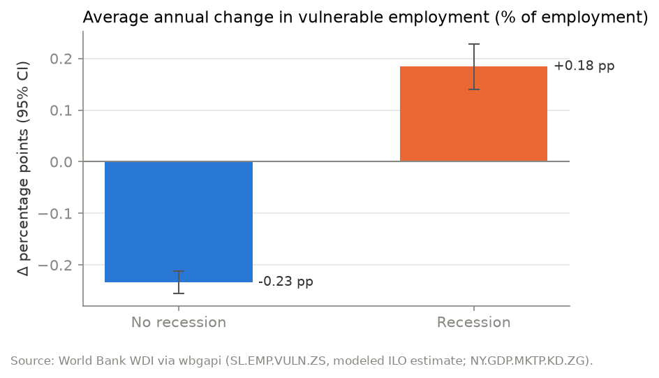
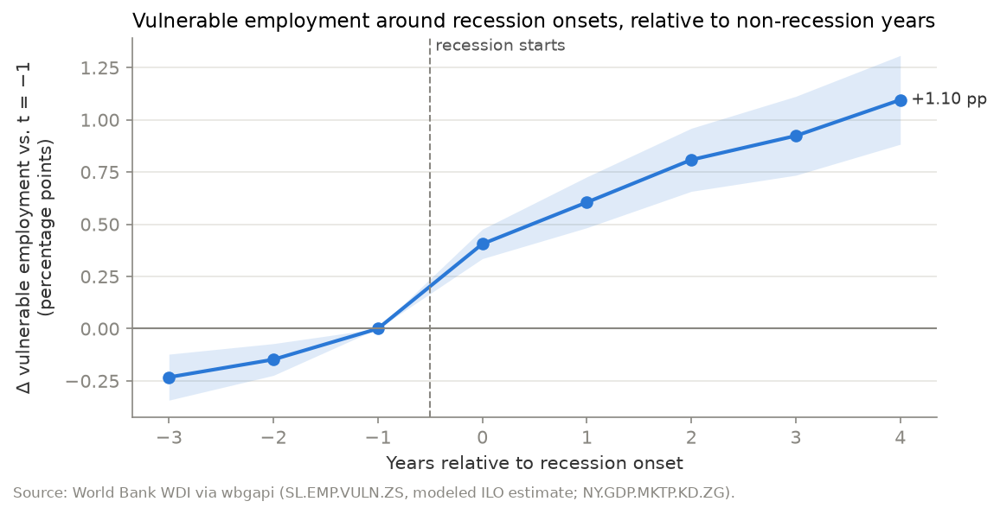
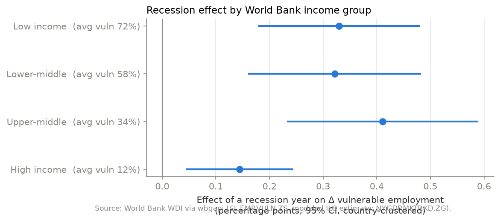

# Does Vulnerable Employment Increase During a Recession?

**ECON 630 project** · Data: World Bank World Development Indicators, pulled with [`wbgapi`](https://pypi.org/project/wbgapi/)

## Summary

**Yes.** Across 185 countries from 1991–2025, vulnerable employment (own-account workers plus contributing family workers, as a share of total employment) rises during recessions. In normal years it falls by about 0.23 percentage points (pp) a year, the long-run trend toward formal wage work. In recession years it *rises* by about 0.18 pp. Comparing each country with itself and netting out global shocks, a recession year adds **+0.28 pp** to the annual change, and the following year adds another **+0.20 pp**. The effect doesn't reverse within four years, and it is two to three times larger in low- and middle-income countries than in high-income ones.

The main caveat is that the vulnerable-employment series is partly *modeled* by the ILO from macro data, including GDP growth (see [Limitations](#limitations)).

## 1. Question and hypothesis

When an economy contracts, formal employers cut hiring and lay off workers. Where unemployment insurance is thin, displaced workers can't afford to stay unemployed, so they move into self-employment or unpaid family work. **Hypothesis: vulnerable employment increases during recessions**, and the increase is larger where informality is common. The full pre-analysis plan is in [`Test/Claude.MD`](Test/Claude.MD).

## 2. Data

| Series | Indicator | Role |
|---|---|---|
| `SL.EMP.VULN.ZS` | Vulnerable employment, % of total employment (modeled ILO estimate) | Outcome |
| `NY.GDP.MKTP.KD.ZG` | Real GDP growth, annual % | Defines recessions |
| `NY.GDP.MKTP.CD` | GDP, current US$ | Cross-check only |

The notebook pulls all of the data from the World Bank API with `wbgapi`, which needs no API key. A cross-check against the CSV files saved in this repo found the two sources **identical** (max difference 0 across 8,176 observations).

**Cleaning:** 1991–2025; dropped 48 regional and income-group aggregates; kept countries with ≥ 10 years of data, leaving **185 countries and 6,138 country-years**. A **recession** is a year with negative real GDP growth: 950 country-years (15.5%) and 573 recession onsets. The **outcome** is the year-over-year change in vulnerable employment, in pp.



Recession years cluster in the early-1990s transition economies, 2009 (47% of countries) and 2020 (80%).

## 3. Results

### Recession years vs. normal years



| | Country-years | Mean Δ vulnerable employment |
|---|---|---|
| No recession | 5,188 | −0.23 pp |
| Recession | 950 | +0.18 pp |

Difference: **+0.42 pp** (Welch t = 16.7, p < 0.001).

### Fixed-effects regressions

Dependent variable: annual change in vulnerable employment (pp). Standard errors (in parentheses) are clustered by country.

| | (1) No FE | (2) Country + year FE | (3) + lagged recession | (4) Continuous growth |
|---|---|---|---|---|
| Recession (t) | 0.418*** (0.034) | 0.326*** (0.041) | 0.279*** (0.039) | |
| Recession (t−1) | | | 0.200*** (0.033) | |
| Real GDP growth (%) | | | | −0.021*** (0.003) |
| N | 6,138 | 6,138 | 6,128 | 6,138 |

\*\*\* p < 0.01. Country fixed effects absorb each country's own formalisation trend; year fixed effects absorb global shocks.

### Timing: event study around recession onsets



Relative to the year before onset, and compared with non-recession windows, vulnerable employment is **+0.41 pp higher in the first recession year and +1.10 pp higher four years later**. The gap keeps widening, so recessions seem to *interrupt* the long-run shift toward wage employment rather than causing a temporary blip. The line is also rising *before* onset, which is discussed under [Limitations](#limitations).

### By income group



| Income group | Recession effect (pp) | Avg. vulnerable employment |
|---|---|---|
| Low income | +0.33*** | 72% |
| Lower-middle | +0.32*** | 58% |
| Upper-middle | +0.41*** | 34% |
| High income | +0.14*** | 12% |

The effect is significant everywhere but much smaller in high-income countries, which fits the mechanism. Where formal jobs and unemployment insurance are common, laid-off workers become *unemployed* rather than self-employed.

## 4. Conclusion

The evidence supports the hypothesis. Recessions raise the share of vulnerable employment, the effect lasts at least two years, and it is concentrated in low- and middle-income economies where informal work is the fallback.

## Limitations

1. **Modeled data.** `SL.EMP.VULN.ZS` is an ILO *modeled* estimate. For country-years without labour-force surveys, it is imputed with models that use macro variables, including GDP growth, so part of the link may be built into the data by construction. A natural next step is to restrict to survey-based observations (ILOSTAT flags these).
2. **Pre-trends.** In the event study, recession countries were already formalising more slowly than the comparison group before onset, so the event-study magnitudes probably overstate the effect. The within-country fixed-effects estimate (+0.28 pp) is the more reliable number.
3. **Comparison group.** The non-recession windows (eight straight years without a recession) come mostly from fast-growing economies.
4. **Recession definition.** Negative annual real growth misses slowdowns and short recessions within a year, and it counts war and disaster collapses as recessions.
5. **Correlation, not a clean causal effect.** Recessions aren't random. Whatever triggers them (commodity busts, conflict, crises) may affect labour markets through other channels too.

## Reproduce

```bash
git clone <this repo>
cd <repo>
pip install -r requirements.txt
jupyter lab Test/recession_vulnerable_employment.ipynb   # Run All
```

The notebook pulls all data live from the World Bank API and runs top to bottom in about a minute. **No API key is needed.** If you add a key-protected source, put the key in a `.env` file. It is listed in `.gitignore`, and the notebook loads it with `python-dotenv` and `os.getenv`.

Results reflect the WDI release current when the notebook was run (vulnerable employment last updated 2026-07-13). Later World Bank revisions may shift the numbers slightly.

## Repository structure

```
├── README.md                                   ← this write-up
├── requirements.txt
├── .gitignore                                  ← excludes .env and other local files
├── API_*.zip                                   ← saved WDI CSV downloads (cross-check only)
└── Test/
    ├── Claude.MD                               ← project plan
    ├── recession_vulnerable_employment.ipynb   ← full analysis
    └── figures/                                ← charts saved by the notebook
```
